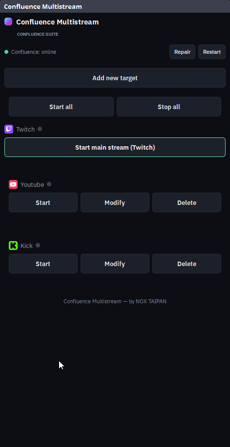
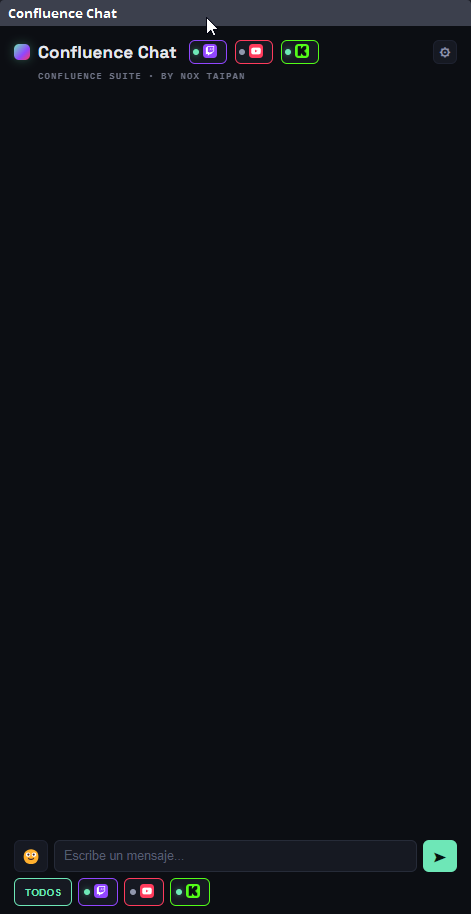

[🇬🇧 English](README.en.md) | 🇪🇸 **Español**

# Confluence Suite

**Confluence Suite** es un conjunto de herramientas gratuitas para streamers que emiten en **Twitch, YouTube y Kick** a la vez, todo dentro de **OBS Studio**:

| Pieza | Qué hace |
|---|---|
| **Stream Info** | Publica título, tags y categoría en las tres plataformas con un solo clic. Crea clips de Twitch. |
| **Chat** | Un chat unificado de Twitch, YouTube y Kick, con emotes, contador de viewers por plataforma y cuadro para responder en cualquiera de ellas. |
| **Overlay Chat** | El mismo chat en modo lectura, para mostrarlo dentro de tu escena. |
| **Multistream** | Plugin nativo de OBS que envía tu video a varios destinos RTMP a la vez (Twitch, YouTube, Kick o cualquier servidor), con botones de iniciar y detener por destino. |
| **Stream Deck** | Plugin de Elgato Stream Deck con 9 acciones para controlar todo lo anterior desde botones físicos. |

Todo corre **en tu propio PC**: no hay servidor central, cuenta ni suscripción. Tú creas tus propias aplicaciones de desarrollador en cada plataforma (se explica en la guía) y tus claves se quedan en tu equipo.

<p>
  
  
  
</p>

## Qué necesitas

- **Windows 10 u 11** (64 bits).
- **OBS Studio 31 o superior** (probado con 32.2).
- Una cuenta en cada plataforma que quieras usar y **una app de desarrollador propia** en cada una (gratis; la guía explica cómo crearla): [Twitch](https://dev.twitch.tv/console/apps/create), [Google Cloud / YouTube](https://console.cloud.google.com/) y [Kick](https://kick.com/settings/developer) (Kick exige activar antes la verificación en dos pasos).
- Para Stream Deck: la app de [Elgato Stream Deck](https://www.elgato.com/downloads) 6.5 o superior.

No hace falta instalar Node.js, Visual Studio ni nada más: el instalador lo trae todo.

## Instalación rápida

1. Descarga **`ConfluenceSetup-<versión>.exe`** desde [Releases](https://github.com/NoxTaipan/confluence-suite/releases/latest).
2. **Cierra OBS** y ejecuta el instalador (no pide permisos de administrador). Windows SmartScreen puede avisar porque el instalador no está firmado: pulsa **Más información → Ejecutar de todas formas**.
3. Elige qué instalar: **Stream Info + Chat + Overlay**, **Multistream**, **plugin de Stream Deck**, o cualquier combinación.
4. Abre OBS. Los docks **Confluence Stream Info** y **Confluence Chat** aparecen solos y el servidor arranca con OBS.
5. Toca la pastilla de cada plataforma en Stream Info: la primera vez pide el *Client ID* y el *Client Secret* de tu app, y luego te lleva a iniciar sesión.

La guía completa, con la creación de las apps de cada plataforma, está en **[INSTALL.md](INSTALL.md)**.

## Cómo funciona

```
 Twitch ─┐                                   ┌─ dock "Stream Info"  (Custom Browser Dock)
 YouTube ┼─ API de cada plataforma ─ Servidor ┼─ dock "Chat"         (Custom Browser Dock)
 Kick  ──┘      (tus claves, en tu PC)  Node  └─ Overlay Chat        (Browser Source en tu escena)
                                      :7773
 OBS ── plugin Multistream ── obs-websocket ── plugin de Stream Deck
```

- **Servidor (`server/`):** una pequeña aplicación Node.js que escucha solo en `localhost:7773`. Gestiona el inicio de sesión (OAuth) con cada plataforma, publica título/tags/categoría, y mantiene los chats abiertos. OBS la muestra como *Custom Browser Docks*.
- **Plugin de OBS (`obs-plugin/`):** un plugin nativo en C++ (basado en [obs-multi-rtmp](https://github.com/sorayuki/obs-multi-rtmp)) con un panel propio. Además de los destinos RTMP, arranca el servidor al abrir OBS y tiene botones **Restart** y **Repair** para él. Expone una API por obs-websocket.
- **Plugin de Stream Deck (`streamdeck/`):** habla con el servidor por HTTP y con OBS por obs-websocket.
- **Instalador (`installer/`):** un asistente de Inno Setup que lleva Node portable y lo instala todo sin tocar nada de tu sistema fuera de las carpetas de la aplicación y de OBS.

## Actualizar, reparar y desinstalar

- **Aviso de actualización:** los docks muestran un banner con un botón **Descargar** cuando hay una versión nueva en GitHub (se comprueba cada 6 horas; solo consulta la versión publicada, sin enviar datos tuyos).
- **Actualizar:** ejecuta el instalador nuevo encima. Tus claves y sesiones se conservan.
- **Reparar:** vuelve a ejecutar el instalador y elige *Reparar*, o usa **Reparar Confluence** del menú Inicio (restaura las dependencias sin internet), o el botón **Repair** del dock de Multistream.
- **Desinstalar:** *Aplicaciones* de Windows, o **Desinstalar Confluence** del menú Inicio. Te pregunta si conservas tus claves.

## Privacidad y seguridad

- Tus *Client ID/Secret* y tus sesiones se guardan **solo en tu PC** (`data/` dentro de la carpeta de instalación).
- El servidor solo acepta conexiones de `localhost`, y su pantalla de configuración rechaza peticiones de otras webs.
- Lo único que sale a Internet, además de las propias plataformas, es la consulta de versiones a la API pública de GitHub.

## Limitaciones conocidas

- YouTube solo permite actualizar una transmisión que ya esté en vivo (no crea una nueva).
- Kick usa una API pública relativamente nueva; si falla la búsqueda de categorías, revisa los endpoints vigentes en [docs.kick.com](https://docs.kick.com).
- Una app de Google Cloud en modo *Testing* caduca el token de YouTube a los 7 días de inactividad (`invalid_grant`); desconecta y reconecta YouTube o publica la app en Google Cloud.
- El instalador no está firmado digitalmente, por eso SmartScreen avisa.
- Solo Windows.

## Compilar desde el código fuente

Está explicado en [INSTALL.md](INSTALL.md#compilar-desde-el-código-fuente): el servidor y el plugin de Stream Deck con Node.js, el plugin de OBS con Visual Studio Build Tools y CMake, y el instalador con Inno Setup.

## Apoyar el proyecto

Todo lo que publico en GitHub, incluido esto, es gratis y de código abierto. Si te sirve y quieres apoyar su mantenimiento, invítame un café:

[](https://ko-fi.com/noxtaipan)

Aparte, en [Gumroad](https://noxtaipan.gumroad.com/) vendo otros productos; esos sí tienen costo. Los *issues* y los *pull requests* son bienvenidos.

## Licencia

El servidor, el plugin de Stream Deck y el instalador son [MIT](LICENSE). El plugin de OBS (`obs-plugin/`) es una obra derivada de [obs-multi-rtmp](https://github.com/sorayuki/obs-multi-rtmp) y se distribuye bajo **GPL-2.0** ([obs-plugin/LICENSE](obs-plugin/LICENSE)); ver [NOTICE.md](NOTICE.md) para los créditos.
