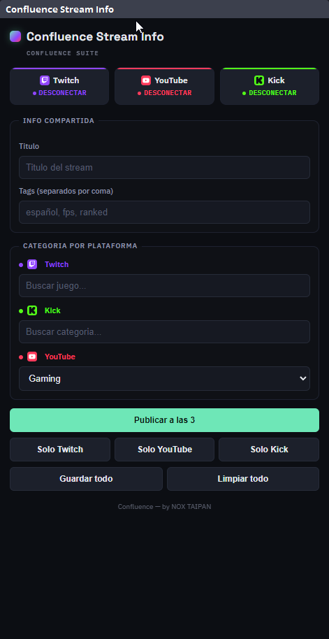

# Confluence Multistream (plugin de OBS / OBS plugin)

Fork de [sorayuki/obs-multi-rtmp](https://github.com/sorayuki/obs-multi-rtmp) (plugin nativo de OBS Studio para enviar video a varios destinos RTMP a la vez), adaptado para **Confluence Suite**: tema oscuro/verde, fuente IBM Plex Sans, español/inglés, soporte de **obs-websocket**, y un indicador del servidor de Confluence con botones **Restart** y **Repair**.

Fork of [sorayuki/obs-multi-rtmp](https://github.com/sorayuki/obs-multi-rtmp) (a native OBS Studio plugin that sends video to several RTMP destinations at once), adapted for **Confluence Suite**: dark/green theme, IBM Plex Sans font, Spanish/English, **obs-websocket** support, and a Confluence server indicator with **Restart** and **Repair** buttons.

- **Instalar / Install:** con el asistente de la suite ([INSTALL.md](../INSTALL.md#instalar-con-el-asistente)) / with the suite's wizard ([INSTALL.en.md](../INSTALL.en.md#install-with-the-wizard)).
- **Compilar / Build:** [INSTALL.md](../INSTALL.md#plugin-de-obs-obs-plugin) · [INSTALL.en.md](../INSTALL.en.md#obs-plugin-obs-plugin).
- **Licencia / License:** GPL-2.0 ([LICENSE](LICENSE), [NOTICE](../NOTICE.md)).
- **Dónde busca el servidor de Confluence / Where it looks for the Confluence server:** variable `CONFLUENCE_DIR`; `HKCU\Software\Confluence\InstallDir`; la misma clave en `HKLM`; `install-dir.txt` en `%APPDATA%\Confluence` y `%PROGRAMDATA%\Confluence`; y por último `%LOCALAPPDATA%\Confluence`. El log de OBS muestra cuál usó (`[obs-multi-rtmp] Confluence dir`). / Environment variable `CONFLUENCE_DIR`; the registry key above, then the same key under `HKLM`; `install-dir.txt` files; finally `%LOCALAPPDATA%\Confluence`. OBS's log shows which one it used.

---

# Fork of main obs-multi-rtmp adding OBS websocket server API support

Adds OBS websocket server API support to the obs-multi-rtmp plugin.

## Complete Websocket API Function List:
ListTargets - Get all configured RTMP targets  
GetTargetState - Get current state of a specific target  
StartTarget - Start a specific target  
StopTarget - Stop a specific target  
ToggleTarget - Toggle start/stop state of a target  
StartAll - Start all targets  
StopAll - Stop all targets  
AddTarget - Add a new target  
CloneTarget - Clone an existing target  
UpdateTargetName - Update target name  
UpdateStreamKey - Update target stream key  
UpdateServiceParam - Update service parameter  
DeleteTarget - Delete a target  
UpdateSyncStart - Sync start with OBS  
UpdateSyncStop - Sync stop with OBS  
GetTargetStats - Get stats of a specific target  

## Python test files:
Look in the folder python_tests for 9 test files that implement each of the API functions for confirmation of websocket functionality

## Notes
I could only compile this for Windows PC. If anyone can help compile and/or package for Mac OS, Linux or Windows installer please let me know!

## Added files:
- multi-output-widget.cpp  
- multi-output-widget.h  
- ws_vendor.cpp  
- ws_vendor.hpp  

## Altered files from source:
CMakeLists.txt  
  - Added websocket support:  
  - lines 41-60  
  - lines 79-82  
  - line 88 ??

pch.h  
  - altered line 27-30 & 37-40 for websocket support

obs-multi-rtmp.cpp  
  - Changes for websocket support:  
  - lines 12-14  
  - line 55-57  
  - line 71 & 87-92  
  - line 99-104  

push-widget.h  
  - Updated for websocket support:  
  - line 1-2  
  - line 6-7  
  - line 9-12  
  - line 19-27  

push-widget.cpp  
  - Updated for websocket support:  
  - line 13-18  
  - line 555  
  - ** I'm not sure if this is all the changes, compare them! **  

I used obs-websocket-5.6.3 for this version found here: https://github.com/obsproject/obs-websocket  
You specifically need to include obs-websocket-api.h  
I added it here: obs-multi-rtmp\\.deps\obs-studio-31.0.0\plugins\obs-websocket\obs-websocket-api.h  

# Build commands used for compiling on PC:
cls  
cd "C:\projects\v2 - 0.7.3\obs-multi-rtmp" -> adjust for your path!  
rmdir /s /q build  
mkdir build  
cd build  
cls  
cmake .. -G "Visual Studio 17 2022" -A x64 -DENABLE_QT=ON -DENABLE_FRONTEND_API=ON -DENABLE_WEBSOCKET=ON  
cmake --build . --config Release  
